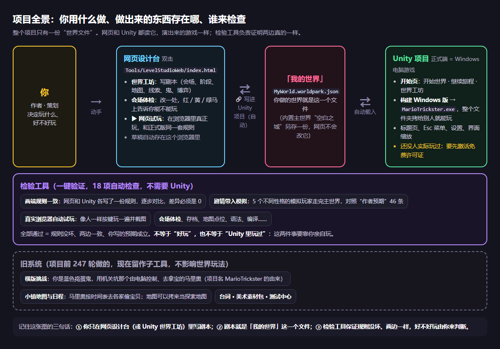

> **当前实操补充（2026-10-22 14:07）**：T08e1公告板调查 / Tab线索本 / 关本暂停已由14:07作者“没问题”按整段实践回报通过。继续任务式学习；当前T08e2从驾驶舱“做伏笔 / 反转”选公告板，在玩家先能看见的事实末尾一次粘贴【练习】，只玩此会场验证，再回世界工坊安全条撤销这一次修改并确认标记去掉。AI不修改世界 / 文案，作者练习保留原文，不改真相 / 条件 / 位置、不写Unity。

> **S259：当前逐步测试**：T01 首页已确认；T02a 作者确认备份已下载；同步状态已确认；T03 地图已打开；T04a 扩宽预览已确认；T04b取消已确认；T05a应用已确认；T05b已确认；T06a原命数3已确认；T06b命数4且校验已确认；T06c撤销已确认；T07a-F02点位导航已修；T07a-F02 12:11已确认画布；T07b 12:16已确认选中；T07c模式已确认；T07d新增已确认；T07e已按文字恢复4格；T07f作者已确认；T08a标题页已确认；T08b入场已确认；T08c两张暂停图与恢复经过已确认；T08c2冻结已确认；T08d1向右已确认；T08d四方向已确认；T08e1已按作者回报通过；当前T08e2编辑公告板事实、试玩验证后撤销恢复。13:59起一轮一个实际任务，边讲用途边连续实践；正常一次回报，卡住才拆细并修复 / 复测；[测试进度与调研待办](GUIDED_TEST_LOG.md) 已保存，原指南和课程仍保留。

# MarioTrickster 项目上手课程：从当玩家，到会改、会做、会提改进

> 写给作者本人（不写代码）。一共 10 课，按顺序上，每课 10–60 分钟，可以分几天上完。每课都有：**这课学什么 → 动手做什么 → 自测题（答案折叠着）→ 记下来**。最后一课教你怎么发现问题、怎么把改进意见告诉 AI。
>
> 配套资料：[世界工坊上手指南](WORLD_WORKSHOP_GUIDE.md)（逐格讲网页世界工坊，本课程会多次让你翻到它的某一节）、[功能地图](../FEATURE_MAP.md)（项目所有功能的完整目录）。
>
> 内容对应 2026-10-21（S255）的项目状态；S256 起加了安全网（撤销、改动记录、恢复原版、看得懂的报错），第 4 课有一个专门的“故意改坏再救回来”练习。S257 起默认是图标驾驶舱，地图有大画布、尺寸 / 扩展和应用返回，横版子工具有按引用返回。完整世界工坊仍保留，课程旧截图对应它。

## 当前任务式学习（13:59调整）

作者要的是会顺畅使用项目，而非逐键验收。现按“一个实际用途→一段连续操作→一次成果反馈”授课：先在游戏中调查 / 看线索本，再在驾驶舱找到对应点位 / 文案；然后改一处并试玩 / 撤销，接着学体检 / 导出、子创作引用和Unity正式端。正常不逐动作截图，只有卡住或新成果需要确认才停下；基础移动已通过不再重复。以下10课仍作知识库，不要求先长篇读完再操作。

## S257 快速练习（先用起来）

打开网页的驾驶舱，选“♣3 三扇门” → 点“画地形 / 改大小” → 扩宽地图 → 先取消，确认世界没有变 → 再扩宽并应用 → 点“摆线索 / 门 / 鬼”看点位仍在 → 点“只玩这个会场” → 不满意用撤销。驾驶舱的阶段图标卡能直接跳到剧情、探索、反转或结局。改地图不再需要先学字符和坐标。

看“项目全景”：地图应用进探索阶段，房间以名字被横版挑战引用，世界包再送到两个运行端。房间另存关卡包，不会随世界包自动打包；Unity 正式游戏仍需要你亲自进去测。

## 学习进度（上完一课就打个勾）

- [ ] 第 0 课　这个项目是什么（5 分钟，读）
- [ ] 第 1 课　当一次玩家（30–40 分钟，玩）
- [ ] 第 2 课　拆开一个会场：♣3 三扇门（20 分钟，对照）
- [ ] 第 3 课　六个会场各自的设计（20 分钟，读；**有剧透，先上完第 1 课**）
- [ ] 第 4 课　动手改：一次只改一个地方（20–30 分钟）
- [ ] 第 5 课　动手做：你的第一个会场（40–60 分钟）
- [ ] 第 6 课　检验工具：体检、剧情模拟、自动试玩（20 分钟）
- [ ] 第 7 课　Unity 和 Windows 版（30 分钟，要先激活免费许可证）
- [ ] 第 8 课　项目全貌：文件在哪、旧系统是什么、怎么存档（15 分钟，读）
- [ ] 第 9 课　发现问题，提出改进（每课结束都可以用）

**准备一个记事本**（纸、手机备忘录、记事本都行）。每课结束时记下三样：我看懂了什么、我哪里没看懂、我觉得哪里不对劲。第 9 课会教你把它们变成改进意见。

**放心乱点。** 网页世界工坊顶上的安全条能撤销任何一步（↶ 撤销 / Ctrl+Z），🕘 改动记录能一次退好几步，主世界的会场随时能“↺ 恢复成原版”；没点“🔗 写进 Unity 项目”之前，Unity 完全不受影响。点错了不知道怎么办，翻[指南第 0 节](WORLD_WORKSHOP_GUIDE.md#0-先记住点错了改乱了都能退回去)那张“遇到情况，查这张表”。

---

## 第 0 课　这个项目是什么（5 分钟）



**一句话：** 这是一个受《弥留之国的爱丽丝》启发的游戏。玩家在一座空无一人的城里醒来，被迫一场接一场地参加“游戏”（会场）。每场游戏有公开规则、扑克牌花色和难度。玩家在限时的现场里调查、躲鬼、选门，或者在博弈桌上和几个有性格的对手斗心。输赢之后会翻出“当时以为 → 其实”的反转，再从门走向下一场。

**你和 AI 怎么分工：** 你是作者兼策划，决定玩什么、好不好玩、哪里要改。AI 是你唯一的程序和关卡助手：写代码、两端一起改、跑检验，并且每次都分开告诉你哪些验证过、哪些没验证。你不需要懂代码，也不需要知道怎么实现。

**记住三样东西：**

| 东西 | 是什么 | 你用它做什么 |
|---|---|---|
| 网页设计台 | 双击 `Tools/LevelStudioWeb/index.html`，不用装任何软件 | 主要的创作工具：写会场、看体检、▶ 网页试玩 |
| Unity 项目 | 正式游戏（Windows 电脑游戏）的源头 | 在正式画面里玩、构建 `.exe` 给别人玩 |
| 检验工具 | AI 每次改完都会跑的 21 项自动检查 | 你不用操作，看结果就行（第 6 课讲怎么看） |

三样东西共用**一份世界文件**。你在网页上写的剧本，Unity 读到的是同一份。规则在网页和 Unity 里各写了一份，检验工具逐步对比，保证两边一模一样。

**为什么项目叫 MarioTrickster：** 前 247 轮开发做的是另一个游戏：你扮演蓝色捣蛋鬼，用机关坑一个由电脑控制、去拿宝的马里奥，还有一个马里奥按时间表去各家偷东西的小镇。第 248 轮起，你决定把主体验改成现在的“世界乐园”。旧东西没删，留作子工具（第 8 课细讲）。所以页面上偶尔会看到“捣蛋者”“马里奥”“守宝房”这类旧词，它们和现在的世界玩法基本无关。

<details><summary>自测：我在网页上改了一个会场，Unity 里的版本会变吗？</summary>

会，前提是你点过一次网页顶部的“🔗 写进 Unity 项目”（选一次项目文件夹）。之后网页每改一次，大约 1 秒后自动写进 Unity 项目里的「我的世界」文件；Unity 的世界工坊会自动载入新版本（如果 Unity 那边有没保存的改动，只提示、不覆盖）。没点过的话，改动只存在这个浏览器里。

</details>

---

## 第 1 课　当一次玩家（30–40 分钟）

**这课学什么：** 先忘掉“作者”身份，用玩家的眼睛体验一遍。作者最容易丢掉的就是第一印象，而它是判断“好不好玩”最准的尺子。

**动手：**

1. 双击 `Tools/LevelStudioWeb/index.html`，点页面顶部的 **▶ 网页试玩**。如果你之前在世界工坊里改过东西，又想玩原版：先点世界工坊顶部“导出 .worldpark.json”备份，再点“载入内置示例”。
2. 标题页点 **开始旅程**（有存档时是“继续旅程”和“从头开始”）。
3. 按键：WASD / 方向键移动，**E 或空格**调查 / 开门 / 继续，**Tab** 线索本，**Esc** 暂停（里面有“重来本会场”）。博弈桌上用鼠标：拖滑块写数字、点花色、点“分 / 偷”。
4. 路线：先打 ♣3；通关后三扇门（♦5、♥7、♠5）任选一个；通关后去 ♥9；再通关去 K，最后在 K 里做一个选择。

**你已经玩过一次了，这次换个玩法：** 剧情模拟器里有 5 种模拟玩家（第 6 课细讲），你也可以各扮演一种。第一遍当“莽”：不读规则，冲最近的门、凭直觉出数字。第二遍当“慎”：每个调查点都看完，再动手。两种玩法的结局差别，就是这个游戏设计的核心。

**每打完一个会场，记下五个问题的答案**（一句话就够）：

| 问题 | 我的回答 |
|---|---|
| 进场 10 秒内，我知道要做什么、怎么算赢、怎么算输吗？ | |
| 我是怎么赢 / 输的？我知道原因吗？觉得冤，还是“我早该想到”？ | |
| 反转卡翻开时，我是“啊！原来如此”、“哦”，还是“这谁猜得到”？ | |
| 最紧张的一刻、最无聊的一刻分别在哪？ | |
| 想马上重来吗？想去下一个会场吗？ | |

<details><summary>自测：我在 ♣3 走错门出局了，结局卡下面的门是灰的。为什么？</summary>

门的条件是“♣3 打出 clear 结局”。出局的结局标签是 dead，条件对不上，所以门是灰的，上面写着需要什么结果。点“重来本会场”就能回到 ♣3 开头再试，别的会场结果保留。

</details>

---

## 第 2 课　拆开一个会场：♣3 三扇门（20 分钟）

**这课学什么：** 刚才玩到的每一个画面，在世界工坊里是哪个格子写出来的。

**动手：** 打开网页设计台的“世界工坊”页，左栏点“♣3 三扇门”，然后按顺序读[世界工坊上手指南](WORLD_WORKSHOP_GUIDE.md)的第 1、2、3 节。读到哪一张截图，就在页面上找到对应的地方，点一点、看一看（先别改）。

**读完应该记住的四件事：**

1. 四层积木：世界 → 会场 → 阶段 → 点位与线索。
2. 中栏那排卡片就是一场游戏的剧本，卡片下面的小字是连线：“→ 下一张”、“胜利 → / 失败 →”、“结算：标签”。
3. 现场探索里，出口决定输赢（win / lose），出口可以要求“先找到某条线索才打得开”。
4. 每条线索两句话：“玩家先能看见的事实”（当时以为）和“作者真相”（其实）。只有**找到了**、又**走到了**指定那张揭示卡，玩家才会看到这张反转。

<details><summary>自测 1：为什么“莽”冲向写着“出口”的大门会死？这是哪个格子决定的？</summary>

选中“候车大厅”卡，在右栏地图上选中“大门”这个出口点位：它的“作者出口结果”是 lose。玩家走到它面前按 E，就按失败结算，走“失败后”指向的“字面的出口”揭示卡。

</details>

<details><summary>自测 2：检修门为什么一开始打不开？</summary>

检修门的 requires（需要先找到的线索）写着测温贴那条线索（`handle_tag`）。没调查过测温贴，按 E 会提示“出口还缺少线索”。测温贴背面写着密码 0310。

</details>

<details><summary>自测 3：通关的人能看到“规则板”的反转卡吗？</summary>

看不到。规则板的“重新解释阶段”是失败那张揭示卡（字面的出口），通关的人走的是“冷的门”，那张卡只翻测温贴。这是故意的：只有掉进陷阱的人才明白“出口”两个字是陷阱。

</details>

---

## 第 3 课　六个会场各自的设计（20 分钟，有剧透）

**这课学什么：** 主世界“空白之城”的六个会场，每个都在示范一种积木用法。读懂它们，你就知道现有积木能搭出什么样的游戏。

花色的意思沿用原作：♠ 体力、♦ 智力、♣ 协作（本项目写作“协作与观察”）、♥ 心理；数字是难度，也是通关后加的签证天数；K 是人头牌。“存活率”是剧情模拟里 5 种模拟玩家各自单独挑战时活下来的比例。

| 会场 | 用了什么积木 | 规则（一句话） | 玩家要发现的事 | 反转（当时以为 → 其实） | 模拟存活率 |
|---|---|---|---|---|---|
| ♣3 三扇门 | 现场探索 35 秒，3 个调查点，3 个出口（1 生 2 死），出口要线索 | 三扇门只有一扇通往外面，规则板每句都是真的 | 规则板说“写着出口的门后面没有出口”；测温贴给出密码 | 致命的不是规则，是“出口”两个字给人的安全感 | 3/5 |
| ♦5 数字猜心 | 多人博弈 beauty，6 人 3 命 8 轮，出局后追加规则 | 每轮写 0–100，平均 × 0.8 最接近的人不扣命 | 别人会往下推几层；每条新规则都会让上一轮最安全的写法变危险 | 白石的笔记本不是草稿，是在算“别人推几层” | 1/5（最难） |
| ♥7 看不见的标记 | 多人博弈 mark，6 人 1 命 4 轮，有说谎者 | 项圈花色自己看不见，只能听别人说，说错就出局 | 公开记录里同一轮他对别人说了什么 | 狐和鸦是主办方的“荷官”；第一轮的真话是为了让你之后相信谎话 | 3/5 |
| ♠5 鬼抓人 | 现场探索 45 秒，2 只鬼（巡逻、视野、追逐），高草 | 被鬼碰到出局，碰到体育馆的旗通关 | 最短的走廊就是鬼的巡逻路线；草里不动可以躲 | 鬼也是参加者：你碰到旗的那一刻，就是他出局的那一刻 | 3/5 |
| ♥9 分还是偷 | 多人博弈 split（囚徒困境），4 人 2 命 6 轮，目标 3 分 | 每轮和一位对手同时选分或偷 | 承诺不要成本；看他上一轮做了什么，而不是说了什么 | 节目单第六幕只写“谢幕”：苇把背叛留到了没有明天的最后一轮 | 2/5 |
| K 主办者的房间 | 现场探索不限时，两个出口当作两个选择，自定义结局标签 leave / stay | 没有计时也没人伤害你，只要决定留下或离开 | 两份名单、监视屏、空白签证（“离开”要先找到名单和签证） | 主办者全部来自通关的玩家；游戏会一直继续，和你留不留下无关 | 5/5（都是结局） |

**看完想一想**（不用回答对错，记下你的直觉）：哪个会场最像原作的感觉？哪个最不像？♦5 只有 1/5 能活，是太难，还是正好？♣ 在原作是团队协作，但 ♣3 是一个人观察，这样可以吗？

<details><summary>自测：如果我想做一个“谁都不能信”的会场，应该参考哪个？</summary>

♥7 和 ♥9。它们都用了会说谎的对手（性格 `liar` 或会在最后一轮背叛的 `deep`），反转都落在“说的话不可信，只有行为和公开记录可信”上。博弈会场的预检会要求至少有一个会欺骗的对手，否则没有“看穿”的空间。

</details>

---

## 第 4 课　动手改：一次只改一个地方（20–30 分钟）

**这课学什么：** 改设计最重要的习惯——**改之前先写下“我预计会怎样”，改完再对照**。预计和实际不一样的地方，往往就是你要找的问题，或者一个新点子。

**动手：** 做[世界工坊上手指南](WORLD_WORKSHOP_GUIDE.md)第 11 节的练习 1（把 ♣3 的限时从 35 改成 20）和练习 2（交换侧门和检修门的生死）。再加一个博弈练习：

**练习 2b：调 ♦5 的难度。** 左栏模板选“♦5 数字猜心”，点“＋ 用模板新建”。选中“写下数字”卡，在右栏博弈参数表单里把“每人命数”从 3 改成 4，下面显示“✓ 博弈参数检查通过”。改之前先写下预计：多一条命，会好打多少？然后 ▶ 只玩这个会场，用你第一次玩 ♦5 的打法再打一次。

**每个练习都填这张小表：**

| 我改了什么 | 我预计会怎样 | 体检说了什么 | 我玩下来实际怎样 | 不一样的地方 |
|---|---|---|---|---|
| | | | | |

所有练习都在“用模板新建”出来的副本上做，主世界不会被改坏。练完不想要了，选中副本，点左栏底部“删除当前会场”（删错了点 ↶ 撤销）。

**练习 4c：故意改坏，再救回来（10 分钟）。** 这个练习的目的，是让你亲眼看到“改坏了会怎样、怎么救”，以后就不怕误操作了。

1. 重现你之前那次误操作：左栏选“K 主办者的房间”，中栏选“钟楼控制室”卡；勾上安全条右边的“显示高级格子”，在右栏探索区点“用小镇页的地图整张替换（高级）”，读完弹窗再点确定。先写下预计：会发生什么？
2. 看安全条“刚才：……｜影响：……”那一句，再看右栏底部的结构预检：它说了在哪、为什么、怎么修。
3. 点 ▶ 只玩这个会场：它会被拦住，按钮正下方写着原因。
4. 用三种办法各救一次，每次救完都点 ↶ 撤销回到“坏掉”的状态，再试下一种：① 结构预检里点“把点挪到最近的空地”；② 点“恢复这个阶段的原版”；③ 直接 ↶ 撤销。
5. 最后看中栏“和内置原版相比”，确认写着“完全一样”。

<details><summary>自测：我在网页上把主世界的 ♣3 改坏了，Unity 里玩的 ♣3 会坏吗？</summary>

不会。网页改的是浏览器里的一份草稿；只有点了“🔗 写进 Unity 项目”，改动才会写进项目里的「我的世界」（`MyWorld.worldpark.json`），而且内置主世界的原件网页永远改不到。即使写进去了，也可以在网页上恢复原版后再写一次。

</details>

<details><summary>自测：我把 ♣3 副本的限时改成 20 秒，为什么规则里还写着 35 秒？</summary>

“入场就应公开的胜负规则”是你手写的普通文字，不会跟着 timeout 自动变，要自己一起改。这是现在的一个难用之处（指南第 12 节第 6 条）。

</details>

---

## 第 5 课　动手做：你的第一个会场（40–60 分钟）

**这课学什么：** 从一个点子到一个能玩的会场。**先在纸上设计，再进工具**：工具只负责把你的设计填进去，点子要先想清楚。

**第一步：填一张会场设计单**（纸上或备忘录里写）：

| 项目 | 你的答案 |
|---|---|
| 花色和难度（♠体力 / ♦智力 / ♣协作 / ♥心理，1–13） | |
| 一句话规则（玩家进场时看到的） | |
| 玩法用哪块积木（现场探索 / 鬼 / 数字猜心 / 看不见的标记 / 分还是偷） | |
| 生路是什么？死路是什么？ | |
| 玩家必须发现什么，才能走对？ | |
| 反转：玩家当时会以为……其实…… | |
| 谁会看到这个反转（通关的人 / 出局的人）？ | |
| 不同性格的玩家（冲动的、谨慎的）各会怎样？ | |

**第二步：进工具。** 照[世界工坊上手指南](WORLD_WORKSHOP_GUIDE.md)第 11 节练习 3 做：选最接近你点子的模板（探索选 ♣3 或 ♠5，博弈选 ♦5 / ♥7 / ♥9），用模板新建，再一处一处换成你设计单里的内容。想从零开始，就照第 11 节最后的“最小会场”配方。

**第三步：验收。** 会场体检没有红色 → ▶ 只玩这个会场，用冲动和谨慎两种玩法各玩一次 → 在“会场之间的入口”里把它接进世界 → ▶ 网页试玩这个世界走一遍 → 满意了点 🔗 写进 Unity 项目。

做到一半发现“这个设计用现有积木搭不出来”，**这正是第 9 课要的东西**：把卡住的那一块记下来。

---

## 第 6 课　检验工具：体检、剧情模拟、自动试玩（20 分钟）

**这课学什么：** AI 每次改完都会说“一键验证 21 项全部通过”。这一课讲这句话到底保证了什么、没保证什么，以及你能怎么利用这些工具。

**会场体检（你自己天天用）：** 在世界工坊中栏下方，改一处自动刷新。红 = 玩不了（必须改），黄 = 有风险（知道为什么就可以留着），绿 = 符合预期。它会真算：读完所有线索要多久、最快多久通关、限时紧不紧；有几个陷阱出口；不理会鬼、直奔出口的玩家几秒被抓；博弈里无脑固定出法能不能赢。详见指南第 9 节。

**剧情带入模拟（AI 来跑，你来读）：** 5 个按固定策略行动的模拟玩家，只凭玩家能看到的信息，用真实规则把主世界逐场走一遍：

| 模拟玩家 | 性格 |
|---|---|
| 莽 | 冲动型：不读完规则就行动，贪图眼前的分数 |
| 真 | 轻信型：觉得显眼的东西是陷阱，但相信别人说的话 |
| 慎 | 谨慎型：先调查再行动，以牙还牙；被鬼追只会拼命跑 |
| 思 | 深思型：推演别人的推演，只看行为不看承诺；盯着鬼的视野走 |
| 随 | 观察型：先调查，跟着局势调整；会躲会等 |

报告在 `.work/worldpark-verify/story/模拟报告.md`（每次一键验证都会重新生成；这个文件夹不进 GitHub，换电脑后让 AI 跑一次就有）。用记事本或 VS Code 打开，重点看两张表：“全程旅程”（每个人走到了哪个结局）和“单会场矩阵”（每个人在每个会场是活是死、用了多久、找到几条线索）。另外 5 份 `旅程_*.md` 是每个模拟玩家的逐句剧情记录，像在看他们的游戏录像。

报告下面的“体验检验”对照的是**作者预期**（现在 46 条），例如“莽单独挑战 ♣3 应该出局，因为冲向写着‘出口’的大门是字面陷阱”。这些预期就是你对“谁该活、谁该死、为什么”的设计意图。你可以随时告诉 AI：“我希望谨慎的玩家在 ♦5 也能活”，AI 会把它加进预期，再调会场直到模拟结果符合你的意图。

**真实浏览器自动试玩：** 程序像人一样按键把主世界玩一遍并截图，截图在 `.work/worldpark-verify/web-play/`。想看最新的游戏画面但懒得自己玩时，可以翻这些截图。

**“21 项全部通过”保证了什么：** 规则没坏；网页和 Unity 两边的规则逐步对比完全一致；你写下的预期都成立；页面能正常打开、能按键玩通。**没保证什么：好不好玩**（模拟玩家不是真人，只能检查公平、紧张、反转有没有出现这些“代理指标”），以及 **Unity 里实际玩起来怎样**（还没人玩过，见第 7 课）。这两件事只能靠你。

<details><summary>自测：体检全绿、一键验证全过，是不是就说明这个会场好玩了？</summary>

不是。它们说明会场“能玩、规则对、你写的预期成立”。好不好玩、反转有没有打动人、节奏拖不拖，只有真人玩了才知道，所以第 1 课的记录表才重要。

</details>

---

## 第 7 课　Unity 和 Windows 版（30 分钟）

**这课学什么：** 正式游戏长什么样、怎么打包给别人玩。目前**还没有任何人在 Unity 里实际玩过**这个世界（这台电脑上的 Unity 许可证没激活，AI 没法替你打开），所以你会是第一个测试者，你的反馈最有价值。

**动手：**

1. 激活免费许可证：打开 Unity Hub → 登录 → 偏好设置 → 许可证 → 添加 → 免费个人版。
2. 双击项目根目录的 `OPEN_MARIOTRICKSTER_UNITY.cmd` 打开项目（第一次会比较慢）。
3. 菜单 `MarioTrickster` → `📖 开始页`（快捷键 Ctrl+Alt+H）。开始页三个主按钮：**开始世界**（从头玩）、**继续旅程**（从检查点接着玩）、**世界工坊**（Unity 版的创作窗口，和网页同一份数据）。
4. 按 [S254 说明](../step1/S254_WINDOWS_AND_AUTHORING.md) 末尾的“自测清单”走一遍（约 20 分钟）：标题页、Esc 菜单、设置界面大小、重来本会场、构建 Windows 版。
5. 构建好的游戏在 `Builds/Windows/` 下以世界编号命名的文件夹里（例如主世界“空白之城”的编号是 `borderland_v1`，就在 `Builds/Windows/borderland_v1/MarioTrickster.exe`），整个文件夹拷给别人就能玩，里面附一份“先读我.txt”。Unity 关着时，也可以双击根目录的 `BUILD_WINDOWS_GAME.cmd` 构建。

**哪里不对，就截图发给 AI**（Win + Shift + S 截图，直接粘贴进对话）。如果 Unity 报错，把 `C:\Users\你的用户名\AppData\Local\Unity\Editor\Editor.log` 这个文件一起发过来。

**网页试玩和 Unity 版的关系：** 规则完全一样（检验工具保证），画面是两套。网页版做过截图检查，Unity 版的排版、字号、颜色可能需要按你的截图调整。

---

## 第 8 课　项目全貌：文件在哪、旧系统是什么、怎么存档（15 分钟）

**你需要知道的文件**（其余都是程序和工具，不用管）：

| 文件 / 文件夹 | 是什么 | 注意 |
|---|---|---|
| `Tools/LevelStudioWeb/index.html` | 网页设计台 | 双击打开；它是程序生成的，不要手改 |
| `Assets/Resources/WorldPark/MyWorld.worldpark.json` | 「我的世界」：你做的世界 | 点过“🔗 写进 Unity 项目”才会出现；AI 不会改你的内容 |
| `Assets/Resources/WorldPark/Borderland.worldpark.json` | 内置主世界“空白之城” | 网页只改它的副本 |
| `Assets/Resources/My*.json`、`MyArtKit.asset` | 你在旧系统里写的台词、美术设置等 | 用户内容，AI 永远不覆盖 |
| `START_HERE.md` | 项目入口说明 | 忘了怎么开始时先看它 |
| `docs/guide/` | 给你看的教程（本课程、世界工坊上手指南） | |
| `docs/FEATURE_MAP.md` | 功能地图：项目所有功能、在哪打开、怎么用 | 网页“功能地图”页和 Unity 开始页显示同一份 |
| `docs/step1/S2xx_*.md` | 每一轮开发的说明（做了什么、验证了什么） | 想知道“某个东西为什么这样”时看 |
| `docs/AI_CONTINUE_PACK/` | 给 AI 看的接续资料 | 换账号或新对话时 AI 靠它接上 |
| `outputs/park-upgrade-20261019/backup/` | 改造成世界乐园之前的完整备份 | 不要删 |

**旧系统**（前 247 轮做的，现在是子工具）：

| 旧系统 | 是什么 | 和现在的世界有什么关系 |
|---|---|---|
| 横版挑战片段（网页“子创作：横版房间”） | 你是蓝色捣蛋鬼，用 15 种机关坑电脑控制的马里奥 | 世界里可以插一个“守宝房”阶段用它；主世界没用到 |
| 小镇地图与日程（网页“子创作：小镇地图”） | 马里奥按时间表去各家偷东西的俯视小镇 | 它的地图可以拷过来当探索地图；地图字符是同一套 |
| 台词、美术素材包、测试中心 | 居民台词编辑、换画风、旧系统的体检 | 基本只服务旧系统 |
| 网页“新机制提案”“交给 AI”页 | 旧的提需求方式 | 现在直接在对话里跟 AI 说就行，这两页的说明有些已经过时 |

你已经授权过可以删掉冗余的旧东西，但要在 Unity 能运行之后确认没有被引用再删，所以目前都还留着。

**存档到 GitHub：** 双击根目录的 `SAVE_MARIOTRICKSTER.cmd`，它会把改动存成一个检查点并推送到 GitHub。AI 在你没要求时不会替你提交。

---

## 第 9 课　发现问题，提出改进

**这课学什么：** 把“感觉哪里不对”变成 AI 能动手改的改进意见。你不需要知道怎么实现，**说清楚感受和你想要的样子，就是最有价值的反馈**。

### 9.1 问题分四类

| 类别 | 什么样 | 例子 |
|---|---|---|
| 玩家体验（好不好玩） | 无聊、太难、看不懂、反转没感觉、出戏 | “♦5 我输了三次都不知道为什么” |
| 创作体验（好不好做） | 找不到在哪改、看不懂格子、要手算手写 | “改轮数要在一堆英文里找 rounds” |
| 能力边界（想做做不到） | 脑子里的设计，现有积木搭不出来 | “我想让玩家在剧情里做选择” |
| 坏了（技术问题） | 卡住、报错、画面错位、存档丢、两端不一样 | “Unity 里字幕卡的字叠在一起” |

### 9.2 找问题的提问清单

**玩的时候问自己：** 进场 10 秒我知道要做什么吗？输了我知道为什么吗？是“我早该想到”还是“这谁猜得到”？线索是不是一眼就看穿，或者根本找不到？反转让我“啊！”了吗？哪一刻最紧张，哪一刻在干等、在读字？我有没有“我在做选择”的感觉？对手和鬼像人吗，我记得住他们吗？想不想马上重来？和原作比，缺了哪种感觉（绝望、背叛、牺牲、同伴）？

**做的时候问自己：** 我想改的东西，30 秒内找得到在哪改吗？有没有看不懂、要猜意思的词？有没有要手算坐标、记 ID、写英文的地方？改错了，体检会提醒我吗？能撤销吗？从“有个点子”到“能玩到”要几步，哪一步最烦？我能一眼看清整个会场、整个世界的结构吗？

**设计的时候问自己：** 我脑子里的会场，用现有积木搭得出来吗？搭不出来的那一块是什么？（对照 9.3）故事里写了、游戏里却没做到的东西有哪些？

### 9.3 现有积木：能做什么、还做不到什么

| 现在能做 | 现在还做不到（需要 AI 加新积木） |
|---|---|
| 剧情字幕卡、揭示 + 反转卡、结局盖章 | 剧情里让玩家做选择（剧情卡只有“继续”；目前只能用探索的出口或博弈的输赢当选择） |
| 现场探索：限时、调查点、出口（生 / 死）、出口要先找到线索 | 一个探索阶段超过两种结果（现在只有“胜利后 / 失败后”两条出路） |
| 鬼：巡逻路线、视野、追逐、高草躲藏（每阶段最多 4 只） | 探索里的同伴 / 队友、会说话的人物、可以拿起使用的道具、会开关的门、灯等机关 |
| 三种多人博弈（数字猜心、看不见的标记、分还是偷）、7 种对手性格、命数、出局、追加规则 | 新的博弈玩法（每种都要 AI 新写规则，并在剧情模拟里加对应的模拟玩家） |
| 自定义结局标签、会场之间按标签开门 | 跨会场的记忆：在一个会场找到的东西影响另一个会场（现在只有结局标签决定开哪扇门） |
| 检查点、继续旅程、重来本会场 | 签证倒计时：签证每天消耗、到期就出局（现在只是结局卡上“签证 +N 天”的文字） |
| 网页试玩、Windows 版、标题页、设置 | 专门的美术与配音（现在是程序画的图形和合成音效）、手柄、触屏 |

右边一栏不是“不能做”，而是“要先请 AI 加积木”。你提出来，AI 会评估工作量，必要时先跟你确认设计。

### 9.4 怎么把问题告诉 AI

直接在对话里发，按这个格式（不会写的格子可以空着）：

```text
【在哪】哪个会场 / 哪个页面 / 第几步
【我做了什么】
【我以为会怎样】
【实际怎样】
【我的感受 / 为什么重要】
【我想要的样子】（可选；越具体越好，但不用管怎么实现）
【有多急】必须改 / 最好改 / 有空再说
（附截图：Win + Shift + S 截图后直接粘贴）
```

**三个写好的例子：**

> 【在哪】世界设定（标题页那段话）和所有结局卡
> 【我以为会怎样】标题页说“签证三天后到期，不参加游戏的人签证到期时出局”，我以为签证会倒计时，拖久了会死
> 【实际怎样】签证只是结局卡上的“+3 天”，没有任何压力
> 【我的感受】原作最绝望的就是签证，现在少了这种“不得不去下一场”的逼迫感
> 【我想要的样子】右上角一直显示签证剩几天；每进一个会场扣一天；通关按牌面加天数；归零就出局
> 【有多急】最好改

> 【在哪】♣3 三扇门
> 【我的感受】♣ 在原作是团队游戏，现在是我一个人观察，花色和玩法对不上
> 【我想要的样子】有一两个 NPC 队友跟着我，各自知道一部分线索，要合作才能开门
> 【有多急】有空再说

> 【在哪】世界工坊 → ♦5 → 写下数字 → 博弈参数
> 【实际怎样】想把命从 3 改成 4，要在一大段英文里找 lives
> 【我想要的样子】轮数、命数做成滑块，对手做成列表，可以点“添加对手”选性格
> 【有多急】必须改

### 9.5 AI 收到以后会怎么做

1. 把你的意见归到上面四类之一，复述一遍确认理解对了；涉及规则或设计取舍的，先给你两三个方案选。
2. 改的时候网页和 Unity 一起改，跑一键验证；改了会场或博弈参数，还会看剧情模拟的结果是否仍符合你的意图。
3. 交付时分开告诉你：哪些已验证、哪些没验证（比如“Unity 里还没实际玩过”）。
4. 界面改了，会同步更新这份课程和世界工坊上手指南。

**提改进的三个层次：** 说出感受（最低要求，也最有价值）→ 指出问题出在哪 → 描述想要的样子。你做到第一层就够了，后两层 AI 可以帮你一起想。

---

## 附：已经发现、等你决定的问题

[世界工坊上手指南](WORLD_WORKSHOP_GUIDE.md)第 12 节列了 11 条（其中博弈参数表单和图上画鬼路线已在 S258 实现，图上编辑地图与图标阶段视图已在 S257 实现；拖线连接、到处是 ID 和英文字段、旧系统残留等仍待改）。上完这门课，你可以回头看那张表，用自己的体验判断哪几条最该先改，也可以加上你自己发现的。
