# 世界工坊上手指南：看懂、改得动、做新关

> 写给作者本人（不写代码）。目标是让你看完以后知道：网页“世界工坊”里每一块是干什么的、你填的每个格子在游戏里变成什么、怎么改现有会场、怎么做一个新会场、改完怎么检验。所有截图都来自当前版本的网页设计台和网页试玩（2026-10-21，S255；第 0 节是 S256 新增的）。建议一边看一边打开 `Tools/LevelStudioWeb/index.html` 对照。
>
> 第 0 节先讲“点错了、改乱了怎么办”，看完就可以放心乱点。最后一节列了我在拆解时发现的难用之处和改法建议，你挑编号告诉我就行。

---

## 0. 先记住：点错了、改乱了，都能退回去

世界工坊页最上面有一条**安全条**，页面往下滚时它一直贴在顶部：

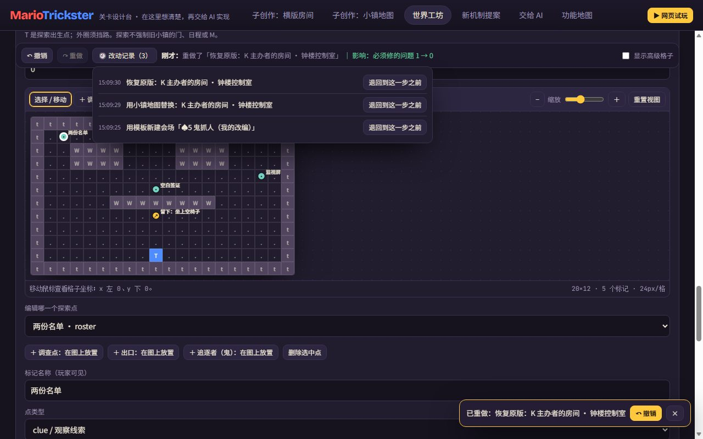

| 安全条上的东西 | 干什么用 |
|---|---|
| **↶ 撤销 / ↷ 重做** | 退回上一步 / 再前进一步，快捷键 Ctrl+Z / Ctrl+Y。删会场、删阶段、换地图、挪点、载入示例……所有改动都能撤销；连续打字算一步。光标在文本框里时，Ctrl+Z 是浏览器自己的“撤销打字”，点一下页面空白处再按就是撤销整步改动 |
| **🕘 改动记录** | 列出每一步改了什么、几点几分（最新的在最上面），点“退回到这一步之前”一次退好几步。同一次打开最多记 200 步；关掉网页再打开，最近二十来步还在 |
| **刚才：……｜影响：……** | 每改一处，这里写出刚才改了什么，以及“必须修的问题”和会场体检的红 / 黄数怎么变。变坏了标红，旁边就有“↶ 撤销这一步” |
| **显示高级格子** | 编号（ID）、玩家角色、“用小镇页的地图整张替换”这类平时用不到、改错了会牵连别处的格子，默认收起；需要时勾上 |

另外还有两层保险。**和原版对比**：主世界的六个会场，以及用模板新建、复制出来的会场，中栏顶部都会写“和内置原版（或模板）相比，改了几处、改了什么”，并有“↺ 整个会场恢复成原版”；右栏选中的阶段如果和原版不同，最上面有“↺ 只恢复这个阶段”。恢复本身也能撤销。**Unity 不受影响**：没点过“🔗 写进 Unity 项目”之前，网页上的所有改动都只在这个浏览器里；内置主世界的原件 `Borderland.worldpark.json` 网页永远改不到。

### 0.1 例子：你误点“复制地图”之后发生了什么

你误点的那个按钮（原名“从当前小镇作者数据复制地图”）会把“子创作：小镇地图”页里正打开的那张小镇（默认是示例小镇）**整张替换**进当前探索阶段。你当时选中的是“K 主办者的房间 · 钟楼控制室”，所以钟楼控制室 20×12 的小房间变成了 44×28 的小镇；原来摆好的 5 个点位还留在原坐标，其中“空白签证”正好落在小镇的一面墙上，玩家碰不到它。这就是那条看不懂的 `v_final/room 点须在可通行格 [explore_point_walkable]`。

世界里只要还有一处“必须修”的问题，整个世界就不能开始，所以“▶ 只玩这个会场”点了也打不开；以前原因只写在页面最上方的一行小字里，看起来就像没反应。现在三处都改了。

**结构预检说人话**：写清在哪个会场、哪个阶段，出了什么事，是哪个点、落在什么格子上，怎么修，下面直接给修复按钮；原来那句技术原文放在最后一行小字里。

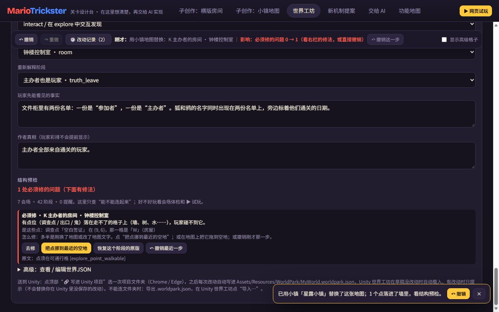

**▶ 被拦住时就地说明**：按钮正下方出现红框，写着为什么还不能玩，同样带修复按钮；修好后红框变成绿色的“现在可以点 ▶ 了”。

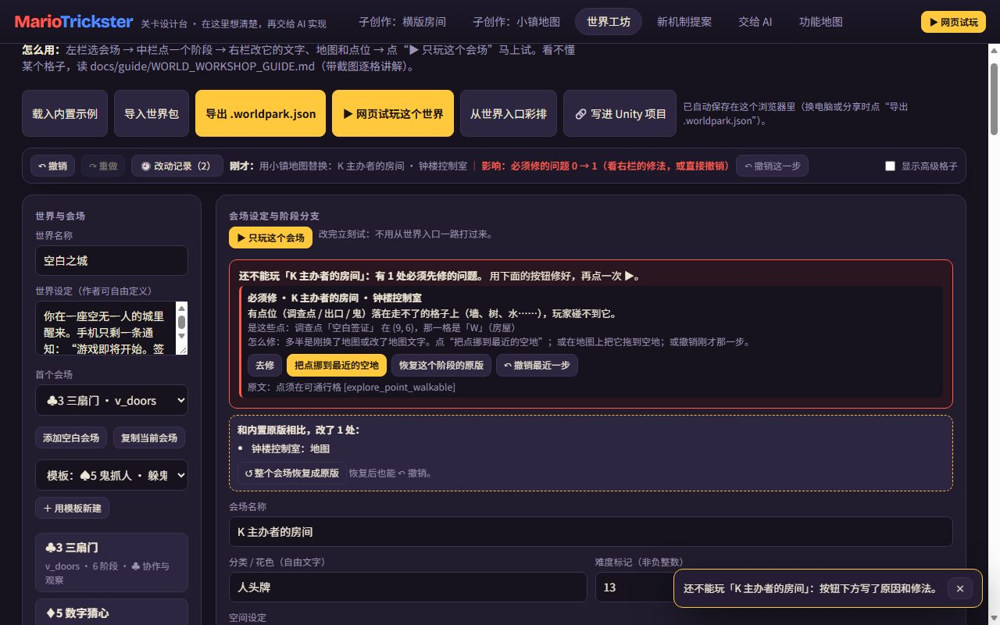

修法三选一。**推荐“恢复这个阶段的原版”**：地图和点位全部回到原样。如果你其实想要新地图，就点“把点挪到最近的空地”，再把点拖到你满意的位置。或者直接 **↶ 撤销**。

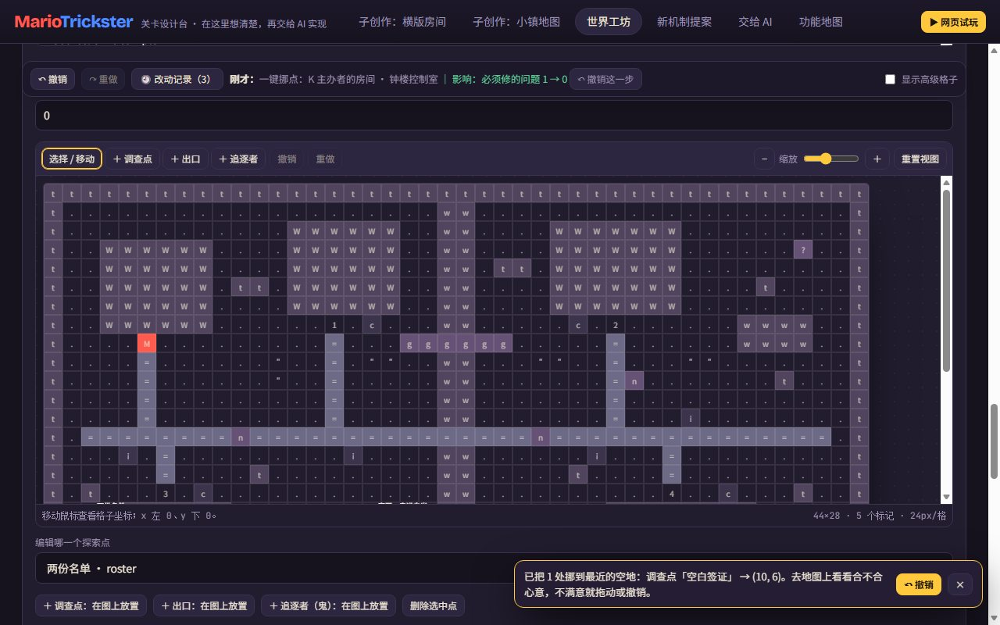

**你现在浏览器里的那份草稿**：那次误点发生在安全网做好之前，所以改动记录里没有它，撤销不回去；但“和内置原版相比”认得出来。打开世界工坊，左栏选“K 主办者的房间”，中栏会写“改了 1 处：钟楼控制室：地图”（你还改过别的，也会一并列出），点“↺ 整个会场恢复成原版”（或右栏的“恢复这个阶段的原版”）就好了。

那个按钮现在改名为“用小镇页的地图整张替换（高级）”，默认收起，点之前会先弹窗说明：要替换哪一张、几个点会落进墙里、换完可以撤销。

### 0.2 遇到情况，查这张表

| 你遇到的情况 | 点哪里 |
|---|---|
| 刚点错了一下 | 安全条 ↶ 撤销（Ctrl+Z） |
| 改了好几步，想回到某一步之前 | 🕘 改动记录 → 退回到这一步之前 |
| 主世界的会场改乱了，想要原样 | 中栏“和内置原版相比”→ ↺ 整个会场恢复成原版；只想恢复一张卡：右栏 ↺ 只恢复这个阶段 |
| 结构预检出现红色“必须修” | 那条下面的按钮：去修 / 把点挪到最近的空地 / 恢复这个阶段的原版 / 撤销最近一步 |
| ▶ 只玩这个会场 打不开 | 看按钮正下方的红框，按里面的按钮修好再点 |
| 删错了会场、阶段、线索或门 | ↶ 撤销（删完右下角的提示里也有撤销按钮） |
| 整个世界都弄乱了 | 顶部“载入内置示例”换回原版空白之城（换完也能撤销） |
| 担心影响 Unity | 没点“🔗 写进 Unity 项目”就完全不影响 |

---

## 1. 一句话看懂：你在写“剧本”，游戏照着剧本演

网页世界工坊**不是游戏本身**，它是一份“剧本 + 地图 + 规则”的编辑器。你在这里填的东西会存成一个世界文件；网页试玩、Unity、以后的 Windows 版都读这同一份文件，按同一套规则演出来，所以网页里玩到的和 Unity 里应该一样。

这份剧本由四层积木搭成：

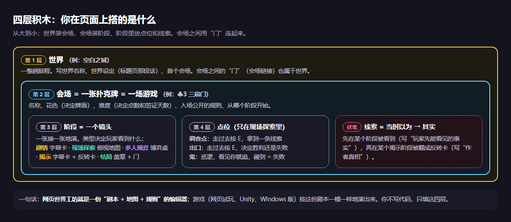

| 层 | 是什么 | 在《弥留之国的爱丽丝》里相当于 | 主世界里的例子 |
|---|---|---|---|
| 世界 | 一整趟旅程 | 整座空无一人的东京 | 空白之城 |
| 会场 | 一场游戏 = 一张扑克牌 | 每一场“游戏”（♣3、♠5……） | ♣3 三扇门、♠5 鬼抓人 |
| 阶段 | 会场里的一个“镜头”，一张接一张地演 | 进场 → 规则宣读 → 游戏进行 → 揭晓真相 → 通关/死亡 | 霓虹亮起 → 候车大厅 → 冷的门 → 第一场通关 |
| 点位与线索 | 现场里能调查的东西、出口、鬼；线索 = 伏笔 | 场地里的道具、暗示、陷阱 | 规则板、测温贴、检修门、走廊的鬼 |

会场之间用“门”（会场链接）连起来：在一个会场打出某个结局，就能从门去下一个会场。

---

## 2. 页面地图：五块区域各管什么

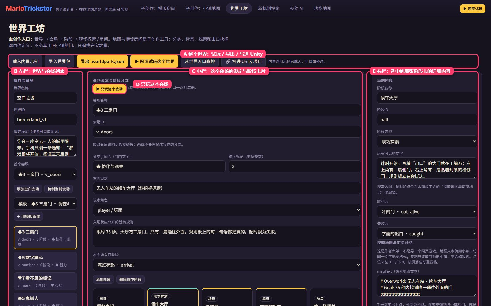

| 区域 | 管什么 | 你什么时候用 |
|---|---|---|
| **A 顶部按钮**（整个世界） | ▶ 网页试玩这个世界（从首个会场开始玩完整旅程）、导出 .worldpark.json（存一份文件）、导入世界包、🔗 写进 Unity 项目、载入内置示例 | 想整趟试玩、备份、送到 Unity 时 |
| **B 左栏**（世界与会场列表） | 世界名称、世界设定（标题页那段话）、首个会场；添加空白会场 / 复制当前会场 / 用模板新建；会场列表（点一下就切换到该会场） | 切换会场、新建会场 |
| **C 中栏**（这个会场） | 会场名称、花色、难度、公开规则、入口阶段；**阶段卡片**（就是你截图里那排卡）；会场之间的入口（门）；会场体检 | 改会场设定、看流程、看体检 |
| **D ▶ 只玩这个会场** | 直接从这个会场入口开始全屏试玩，不用从第一关打过来 | 每次改完立刻试 |
| **E 右栏**（选中的那张阶段卡） | 点中栏的哪张卡，右栏就显示哪张卡的详细内容：文字、往哪走、探索地图与点位、线索、博弈参数 | 真正“写内容”的地方 |

**可以先不管的东西**（大多是旧系统留下的，不影响世界玩法）：会场里的“玩家角色”（trickster/player，世界里不改变玩法）；阶段类型里的“守宝房”（旧横版房间，网页试玩里只能手动选守住/失守）和“新玩法草稿”；“从世界入口彩排”和“玩家视角阶段彩排”面板（早期的文字彩排，现在有真正的网页试玩了）；“高级：查看 / 编辑世界JSON”；所有“ID”格子（会场ID、阶段ID、线索ID，系统用来互相引用；S256 起和“玩家角色”一起默认收起，安全条右边勾“显示高级格子”才出现）。右栏底部的“结构预检”平时不用看，出现红色“必须修”时照着它的按钮修就行（见第 0 节）。顶部其他标签页（子创作：横版房间、子创作：小镇地图、新机制提案、交给 AI）也是旧工具或辅助工具。

---

## 3. 拿 ♣3 三扇门 拆开看：你填的格子 → 玩家看到的画面

你截图里那 6 张阶段卡，连起来是这样一场游戏：

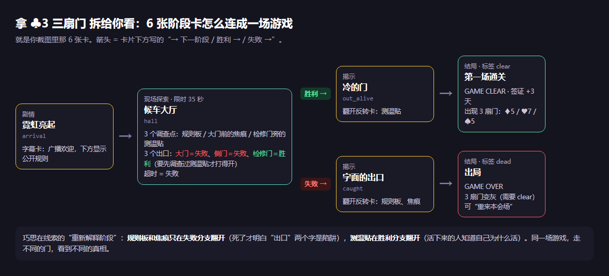

卡片下方的小字就是连线：剧情和揭示卡写“→ 下一阶段”，现场探索卡写“胜利 → / 失败 →”，结局卡写“结算：标签”。下面按玩家实际经历的顺序，对照你填的格子。

### 3.1 入场霓虹：会场的“牌面”

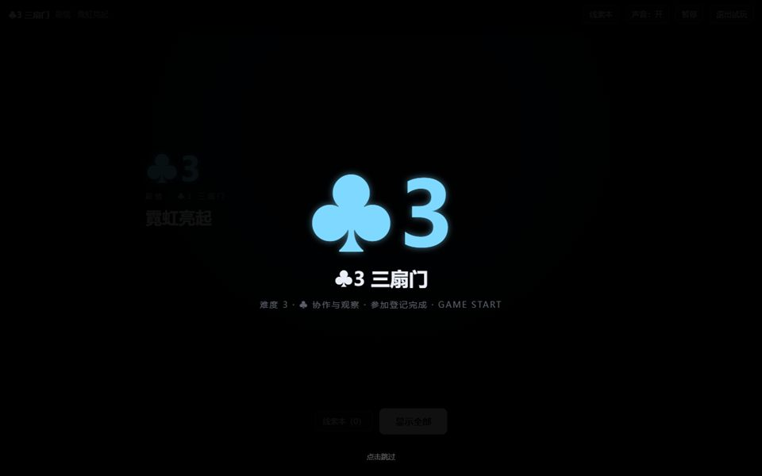

牌面 ♣3 来自会场的两个格子：**分类 / 花色**的第一个字符（♠♥♦♣ 之一，♥♦ 是红色调，♠♣ 是冷色调）和**难度标记**（数字就是点数，1 = A，11 = J，12 = Q，13 = K）。下面一行“难度 3 · ♣ 协作与观察 · 参加登记完成 · GAME START”也来自这两个格子。

### 3.2 剧情卡：阶段名称是标题，“玩家可见的文字”是正文

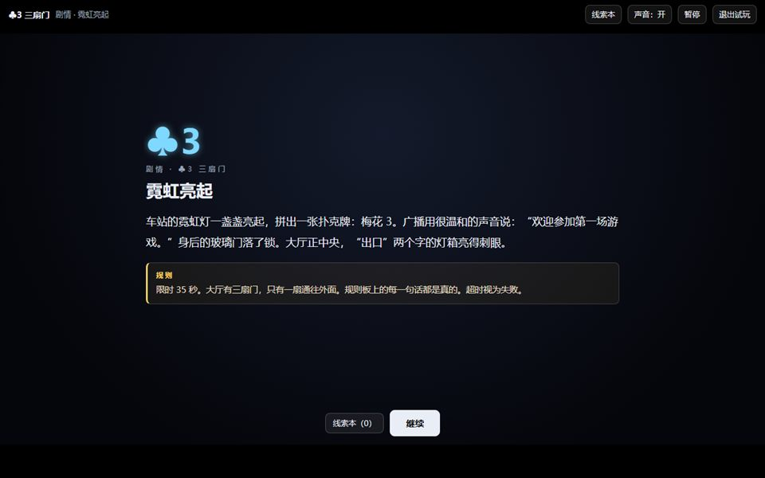

大标题“霓虹亮起”是**阶段名称**，正文是**玩家可见的文字**（会一个字一个字打出来）。下方黄色的“规则”框是会场的**入场就应公开的胜负规则**，只在会场的入口剧情卡出现一次；之后玩家随时能在线索本旁边重看规则。点“继续”就走到“下一阶段”。

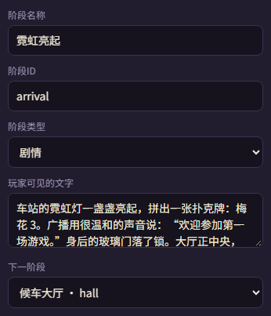

### 3.3 现场探索：地图、倒计时、调查点、出口

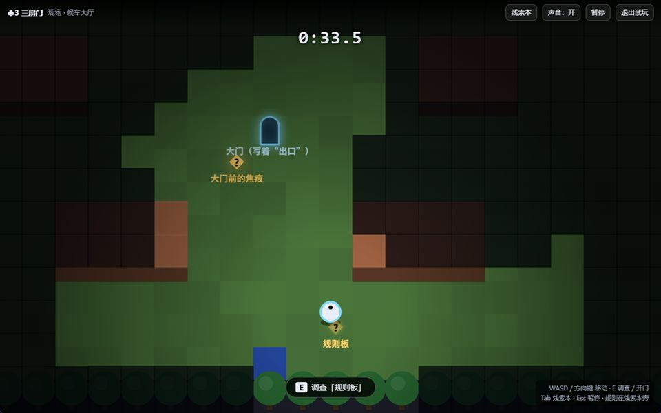

这是俯视地图。地图本身来自右栏的 **mapText（探索地图文本）**，顶部倒计时来自 **timeout**（35 秒；填 0 就不限时）。带“?”的是**调查点**，门的图标是**出口**，旁边的字是你给点位写的**标记名称**。玩家用 WASD 走过去、贴近（大约 1 格内、中间没有墙）按 E：

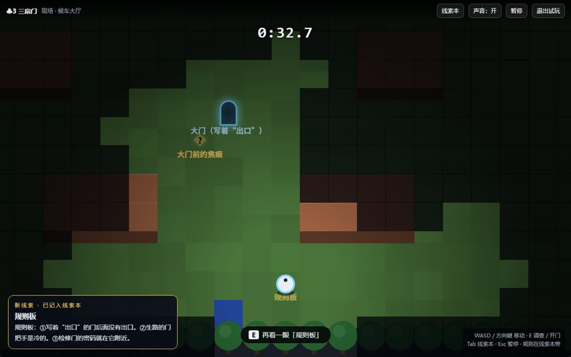

调查点弹出线索卡，内容是这条线索的**玩家先能看见的事实**，同时记进线索本（Tab 打开）。出口按 E 就决定这场是“胜利”还是“失败”；如果你给这个出口设了“需要先找到的线索”，玩家没找到时会提示“出口还缺少线索：……”，打不开。时间耗尽算失败。

### 3.4 揭示 + 反转卡：这个游戏的“原来如此”

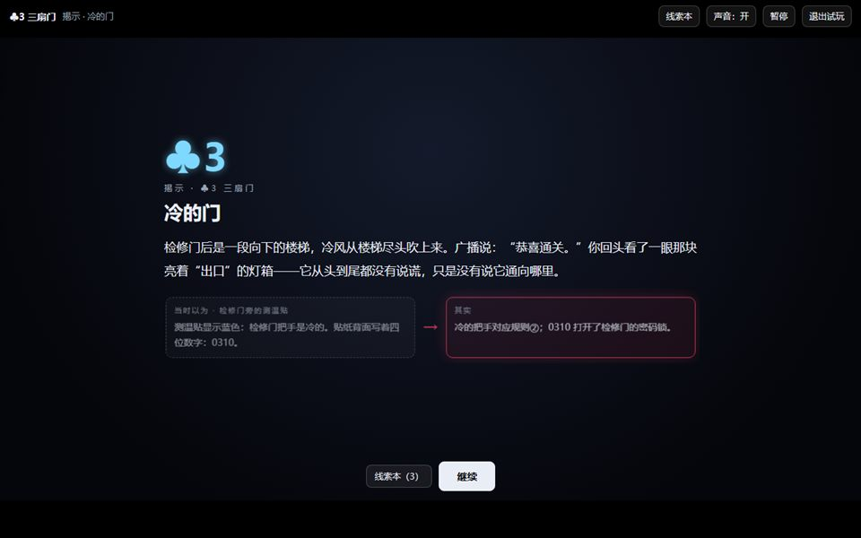

揭示阶段和剧情卡一样有标题和正文，但下面多了**反转卡**：左边“当时以为”是线索的“玩家先能看见的事实”，右边“其实”是线索的“作者真相”。一张揭示卡会翻开哪些反转，取决于每条线索的**重新解释阶段**是不是这一张；玩家没找到的线索会显示成“你错过了”。

### 3.5 结局：盖章 + 门

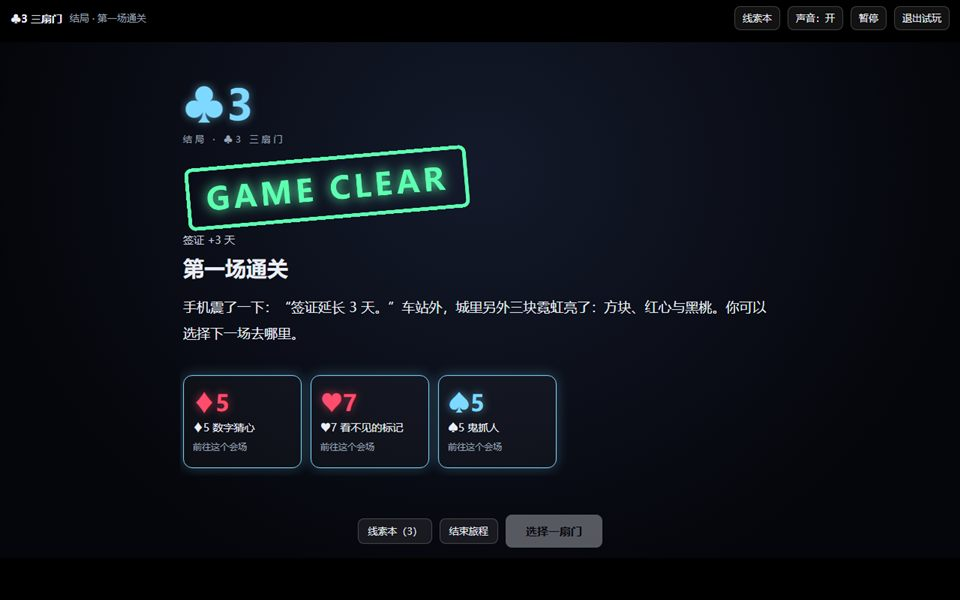

结局卡的盖章由**本场结局标签**决定：

| 结局标签 | 盖章 | 说明 |
|---|---|---|
| `clear` | GAME CLEAR，下面写“签证 +N 天” | N 就是会场的难度标记 |
| `dead` 或 `fail` | GAME OVER | 玩家可以“重来本会场”或“结束旅程” |
| 其他任何词（如 `leave`、`stay`） | 旅程终点 | 自定义结局，K 终局就是这么用的 |

下面那几扇门来自“会场之间的入口”：所有“来源 = 这个会场”的链接都会显示成门，条件对得上的门可以走，对不上的门是灰的，写着需要什么结果。

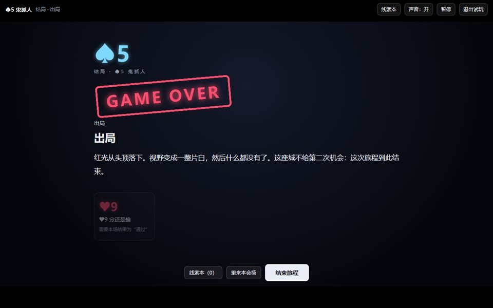

### 3.6 一张对照表

| 你在页面上填的格子 | 在游戏里出现在哪 |
|---|---|
| 世界设定 | 标题页那段话 |
| 会场名称 / 分类花色 / 难度标记 | 入场霓虹的牌面、左上角会场名、结局的“签证 +N 天” |
| 入场就应公开的胜负规则 | 入口剧情卡的“规则”框；线索本旁的规则 |
| 空间设定 | 规则抽屉里的场地说明 |
| 阶段名称 | 字幕卡大标题、左上角“剧情 · 霓虹亮起” |
| 玩家可见的文字 | 剧情 / 揭示 / 结局卡的正文（现场探索阶段的这段文字，网页试玩目前不显示，见第 12 节） |
| mapText / timeout | 探索地图 / 倒计时 |
| 点位的标记名称 | 地图上点位旁边的字 |
| 线索：玩家先能看见的事实 | 调查后弹出的线索卡、线索本、反转卡左边 |
| 线索：作者真相 | 反转卡右边“其实” |
| 本场结局标签 | 结局盖章、哪些门能走 |
| 会场之间的入口 | 结局卡下面的门 |

---

## 4. 阶段类型：每种怎么填

右栏“阶段类型”下拉里有 7 种，常用的是前 5 种：

| 类型 | 游戏里是什么 | 要填的格子 | 往哪走 |
|---|---|---|---|
| 剧情 | 字幕卡（点继续） | 阶段名称、玩家可见的文字 | 下一阶段（一条） |
| 现场探索 | 俯视地图：走、调查、躲鬼、选出口 | 地图、限时、点位（见第 5 节） | 胜利后 / 失败后（两条） |
| 多人博弈 | 全屏博弈桌（数字猜心 / 看不见的标记 / 分还是偷） | 博弈参数（见第 7 节） | 胜利后 / 失败后（两条） |
| 揭示 | 字幕卡 + 反转卡 | 阶段名称、玩家可见的文字；线索那边设“重新解释阶段 = 这一张” | 下一阶段（一条） |
| 结局 | 盖章 + 门 | 阶段名称、玩家可见的文字、本场结局标签 | 没有下一步，走门去别的会场 |
| 守宝房（旧） | 旧横版房间关卡 | 关联现有房间名称 | 胜利后 / 失败后 |
| 新玩法草稿 | 只是记点子，不能运行 | — | — |

**“胜利后 / 失败后”其实就是“两条出路”**，不一定是活和死。K 主办者的房间就用它表示“离开 / 留下”两个选择，两边都是正经结局：

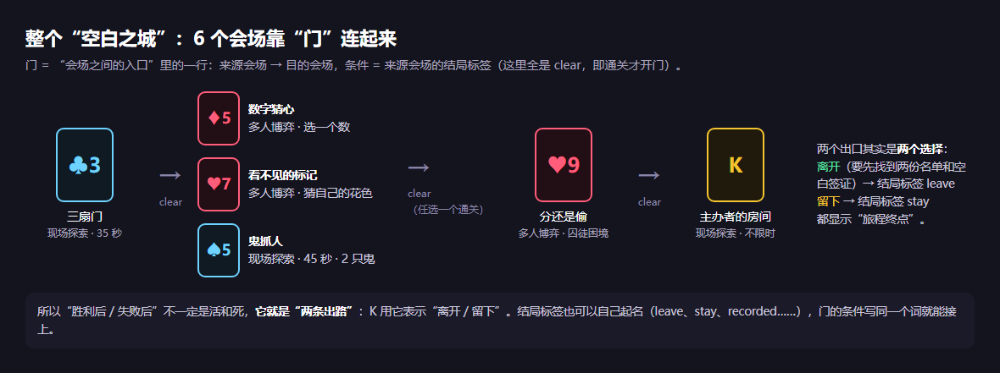

一个会场的标准骨架是：剧情（进场、宣读规则）→ 现场探索或多人博弈 → 两张揭示（胜利那边一张、失败那边一张）→ 两个结局。6 个内置会场全是这个骨架，你做新会场也可以照抄。

---

## 5. 现场探索：地图、调查点、出口、鬼

选中一张“现场探索”卡，右栏下半部分会出现“探索地图与可见标记”：

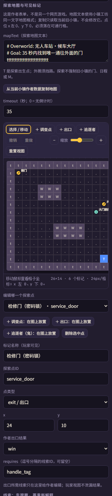

### 5.1 地图是一格一个字符

mapText 里每一行是地图的一行，每个字符是一格；以 `#` 开头的行是注释。常用字符：

| 字符 | 是什么 | 能走吗 | 挡视线吗 |
|---|---|---|---|
| `.` | 草地 / 地面 | 能 | 不挡 |
| `=` | 石子路 | 能 | 不挡 |
| `"` | 高草 | 能 | 藏人：站着不动时，鬼贴身之前看不见你；在草里走动草会晃 |
| `t` | 树 | 不能 | 挡 |
| `W` | 房屋 / 墙 | 不能 | 挡 |
| `c` | 木箱（掩体） | 不能 | 挡 |
| `w` | 水 | 不能 | 不挡 |
| `f` | 栅栏 | 不能 | 不挡 |
| `T` | 玩家出生点（必须有且只有一个） | 能 | — |

不认识的字符一律当墙。地图外圈要用不能走的格子围住。目前世界工坊里**只能打字改地图**。勾上“显示高级格子”后还有一个“用小镇页的地图整张替换（高级）”：把“子创作：小镇地图”页当前那张小镇整张换进来（会先确认，并告诉你几个点会落进墙里；换完能撤销），一般用不到。

### 5.2 放点位：调查点、出口、鬼

画布上方的按钮：“＋ 调查点”“＋ 出口”“＋ 追逐者”，点一下按钮再点地图上能走的格子，就放下一个点；“选择 / 移动”可以拖动已有的点。放调查点时会**自动建一条同名线索**。坐标的规则是 x 从左往右数、y 从**下**往上数，都从 0 开始；鼠标移到格子上会显示坐标，通常不用自己算。

选中一个点后，下面能改它的属性。出口有两个关键格子：**作者出口结果**（win = 走这扇门算胜利，lose = 算失败）和 **requires**（要先找到哪些线索才打得开，写线索 ID，用逗号隔开，留空就随时能开）。♣3 里检修门是 win、需要先调查测温贴（`handle_tag`），大门和侧门都是 lose，所以玩家必须调查、理解规则板，才会选对门。

### 5.3 输赢怎么判

玩家在出口按 E：按那扇门的 win/lose 结算。倒计时归零：失败。被鬼碰到：失败。结算后走“胜利后”或“失败后”指向的阶段。

### 5.4 鬼（追逐者）

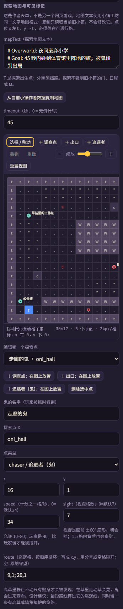

鬼有三个参数：**speed** 是移动速度，单位是十分之一格每秒，默认 34 即 3.4 格/秒（玩家是 4 格/秒，所以玩家略快）；**sight** 是视距，默认 7 格，鬼只看得见它面前一个扇形范围；**route** 是巡逻路线，按顺序写几个格子坐标，比如 `9,1; 20,1` 就是在两点之间来回走，留空就原地守望。鬼看见玩家就会追，碰到就失败；站在高草里不动，鬼贴身之前看不见你。

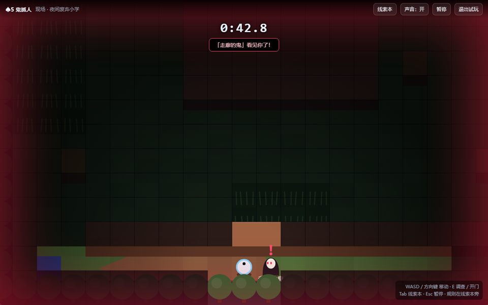

---

## 6. 线索与反转：这个游戏的灵魂

右栏中部“线索：先观察，再重新解释”：

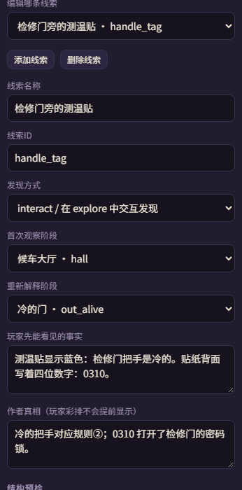

| 格子 | 意思 |
|---|---|
| 线索名称 | 线索卡和线索本上的标题 |
| 玩家先能看见的事实 | 玩家调查时看到的内容；也是反转卡左边“当时以为” |
| 作者真相 | 反转卡右边“其实”；揭示之前玩家看不到 |
| 发现方式 | interact = 在探索里走过去按 E 才拿到（常用）；stage = 进入某个阶段就自动拿到 |
| 首次观察阶段 | 在哪个阶段能拿到这条线索 |
| 重新解释阶段 | 在哪张揭示卡上翻成反转卡 |

反转卡只在两个条件同时满足时出现：玩家**确实找到了**这条线索，并且他**走到了**“重新解释阶段”指定的那张揭示卡。所以设计反转时要想清楚“谁会看到”。♣3 的做法很巧：规则板和焦痕在**失败**那张揭示卡（字面的出口）翻开，测温贴在**胜利**那张（冷的门）翻开。死掉的人才明白“出口”两个字是陷阱，活下来的人知道自己为什么活。同一场游戏，走不同的门，看到不同的真相。

---

## 7. 多人博弈：参数怎么读

选中一张“多人博弈”卡，右栏会出现“博弈参数（JSON）”文本框。它现在是一段要手写的文字（这是目前最难用的地方之一，见第 12 节），例如 ♦5 数字猜心：

```json
{ "mode": "beauty", "rounds": 8, "lives": 3, "ratio": 80, "goal": 0, "seed": 7, "escalate": 1,
  "seats": [ { "id": "me",  "name": "你",   "persona": "player" },
             { "id": "jiu", "name": "阿久", "persona": "naive" },
             { "id": "bai", "name": "白石", "persona": "reasoner" },
             { "id": "wei", "name": "苇",   "persona": "deep" },
             { "id": "du",  "name": "渡",   "persona": "adaptive" },
             { "id": "ming","name": "鸣",   "persona": "adaptive" } ] }
```

| 参数 | 意思 |
|---|---|
| mode | 玩法：`beauty` 数字猜心（选 0–100，最接近平均数×比例的人赢）、`mark` 看不见的标记（猜自己项圈上的花色，只能听别人说）、`split` 分还是偷（囚徒困境） |
| rounds | 最多几轮 |
| lives | 每人几条命 |
| ratio | 只用于数字猜心：平均数乘以多少，80 = ×0.8 |
| goal | 只用于分还是偷：玩家最后至少要多少分 |
| escalate | 只用于数字猜心：1 = 有人出局后每轮追加新规则，0 = 不追加 |
| seed | 随机种子：同一个数字，每次开局的随机情况（比如花色）都一样；换个数字就换一局 |
| seats | 座位表：每个座位有 id、名字和性格；**必须恰好有一个 `player`（玩家本人）** |

对手性格（persona）：`naive` 直觉型、`reasoner` 推一层、`deep` 深推、`adaptive` 跟随者、`liar` 说谎者、`loyal` 老实人、`mirror` 以牙还牙。改完点到文本框外面，会显示“博弈参数检查通过”或错误原因。

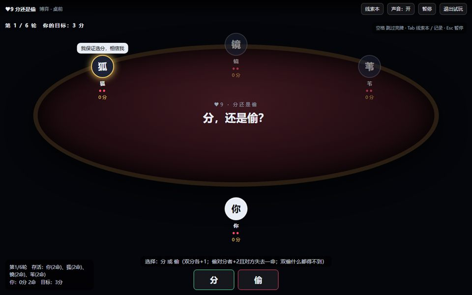

博弈桌上玩家看到的是座位、命数、分数、对手的台词和每轮的选项。胜负由规则引擎算：赢了走“胜利后”，输了走“失败后”。

---

## 8. 结局与门：会场怎么串成一座城

中栏“会场之间的入口”是**整个世界共用的一张门表**（不是只属于当前会场）：

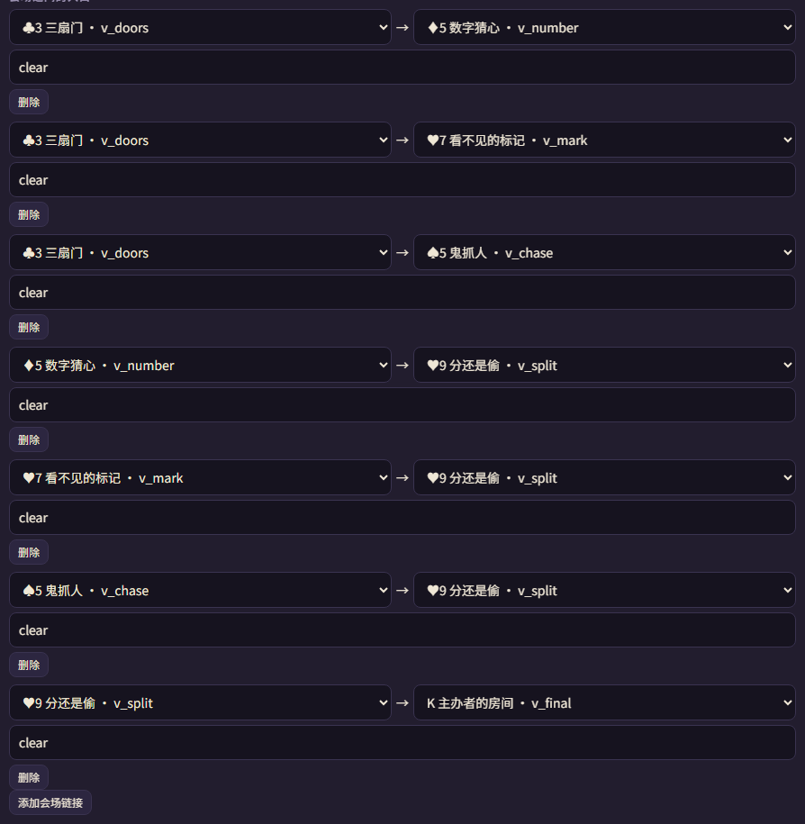

每一行是一扇门：来源会场 → 目的会场，条件 = 来源会场打出的结局标签。`clear` 就是“通关才开”；写 `any` 表示不管什么结局都开；写自定义标签（如 `leave`）就只在打出那个结局时开。左栏的**首个会场**决定整趟旅程从哪开始。主世界的连法是：♣3 通关后开 ♦5 / ♥7 / ♠5 三扇门，这三个任选一个通关后开 ♥9，♥9 通关后开 K。

---

## 9. 改完怎么检验

**最快：▶ 只玩这个会场**（中栏顶部）。直接从这个会场入口开始全屏试玩，改一处试一次。如果世界里还有“必须修”的问题，它会被拦住，原因和修复按钮就显示在按钮正下方（见第 0 节）。

**会场体检**（中栏下方）：用和试玩同一套规则真算出来的设计建议，每改一处自动刷新。红 = 玩不了（比如出口永远打不开），黄 = 体验有风险，绿 = 符合预期。它会告诉你：走完并读完所有线索要多少秒、最快多少秒能通关、限时紧不紧；有几个陷阱出口；“直奔出口、不理鬼”的玩家几秒被抓；博弈里“固定出法”能不能无脑赢。

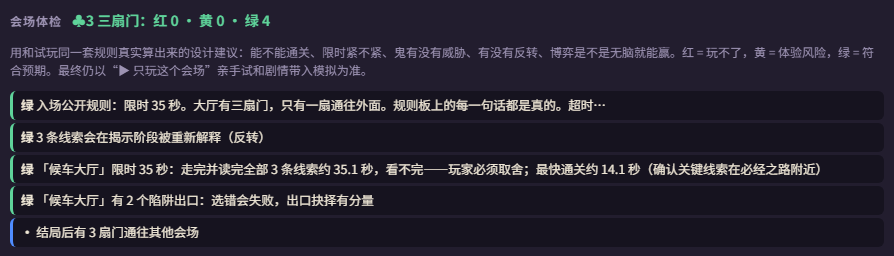

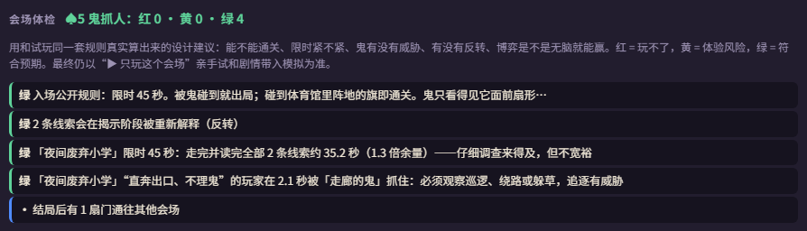

**完整旅程：▶ 网页试玩这个世界**（顶部），从首个会场一路玩，检查门是否接得上、节奏好不好。

**剧情带入模拟（进阶）**：仓库里有一个模拟器，让 5 个不同性格的“模拟玩家”（莽 冲动型、真 轻信型、慎 谨慎型、思 深思型、随 观察型）把主世界逐场玩一遍，并对照作者写下的预期检查（现在 46 项）。例如其中一条是“莽单独挑战 ♣3 应该出局，因为冲向写着‘出口’的大门是字面陷阱”。这个由我来跑：你改了主世界或博弈参数后跟我说一声，我把报告给你。

**Unity**：点 🔗 写进 Unity 项目，Unity 的世界工坊会自动载入，再在 Unity 里开始世界或构建 Windows 版。

---

## 10. 你的东西存在哪、会不会丢

| 位置 | 是什么 | 注意 |
|---|---|---|
| 浏览器草稿 | 你在网页上的每一次改动都会自动存在**这个浏览器**里 | 换浏览器或清除浏览器数据就没了。重要的东西记得导出或写进 Unity |
| 导出的 .worldpark.json | 一份完整的世界文件 | 最稳的备份，也能在 Unity 里“导入…” |
| `Assets/Resources/WorldPark/MyWorld.worldpark.json` | 点“🔗 写进 Unity 项目”后写进项目的「我的世界」 | 之后每次改动自动同步；Unity 里有没保存的改动时只提示，不会覆盖 |
| `Assets/Resources/WorldPark/Borderland.worldpark.json` | 内置主世界“空白之城” | 网页改的是它的**副本**，原件不会被网页改动 |
| 改动记录（撤销历史） | 也存在这个浏览器里 | 关掉网页再开，最近二十来步还能撤销；清除浏览器数据会一起清掉 |

“载入内置示例”会把草稿换回原版空白之城（会先确认，换完点 ↶ 撤销就能换回你的草稿）。练手时建议用“＋ 用模板新建”或“复制当前会场”，在副本上改，主世界保持完好。

---

## 11. 三个上手练习（每个 5–10 分钟）

**练习 1：调难度，感受限时。** 左栏模板选“♣3 三扇门”，点“＋ 用模板新建”，得到一个副本会场。选中“候车大厅”卡，把 timeout 从 35 改成 20。看会场体检那条“限时”的话怎么变，再点 ▶ 只玩这个会场亲自跑一遍。注意：公开规则里写的“限时 35 秒”是普通文字，不会跟着变，记得一起改。

**练习 2：换生路，感受出口设计。** 在同一个副本里，选中“侧门”，把作者出口结果改成 win；再选中“检修门”改成 lose。看体检怎么评价，再试玩：现在规则板的话还对得上吗？这个练习能让你体会“线索 → 出口 → 反转”是怎么咬合的。

**练习 3：做一个自己的会场并接进世界。** 用模板新建一个“♠5 鬼抓人”，然后按顺序改：会场名称、花色和难度（决定牌面）、公开规则；剧情卡的文字；探索的地图、鬼的路线、调查点的名称；每条线索的“事实”和“真相”；两张揭示卡和两个结局的文字。体检全绿后，▶ 只玩这个会场试玩。最后在“会场之间的入口”点“添加会场链接”，来源选 ♣3、目的选你的新会场、条件写 `clear`，再点 ▶ 网页试玩这个世界：♣3 通关后就会多一扇通往你会场的门。满意了点 🔗 写进 Unity 项目。

**从零做一个最小会场**（不用模板）：添加空白会场 → 依次添加 6 个阶段：剧情（下一阶段 = 探索）、现场探索（胜利后 = 揭示 A，失败后 = 揭示 B）、揭示 A（→ 结局 A）、揭示 B（→ 结局 B）、结局 A（标签 clear）、结局 B（标签 dead）→ 在探索里写一张有 `T` 的小地图，放 1 个调查点、1 个 win 出口、1 个 lose 出口 → 把那条线索的重新解释阶段设成揭示 A 或 B → 本会场入口阶段选剧情卡 → 看体检、试玩。

---

## 12. 我在拆解时看到的难用之处（请你挑要改的）

下面是我为写这份指南把整个页面走了一遍后，站在“不写代码的作者”角度看到的问题。除了表格后面注明做了一半的两条，其余都还**没有改**，等你决定。

| 编号 | 现在的问题 | 建议改法 | 对你的影响 |
|---|---|---|---|
| 1 | 博弈参数只能手写 JSON（花括号、引号、英文字段） | 改成表单：玩法下拉、轮数 / 命数滑块、座位表（加座位、起名字、性格下拉） | 大：做博弈会场不再需要懂格式 |
| 2 | 世界工坊里不能“画”探索地图，只能打字或从小镇页复制；画布挤在右栏，只看得到半张地图 | 在世界工坊里直接加地形笔刷（地面 / 墙 / 树 / 高草 / 出生点），地图编辑区放大到中栏或全屏 | 大：做探索会场最费劲的一步 |
| 3 | 阶段之间靠下拉框选 ID 连起来，看不出整场流程 | 中栏改成流程图（像本指南第 3 节的图）：拖线连卡片，卡片上直接显示胜利 / 失败去哪、哪些线索在这里翻开 | 大：调整已有大框架最需要的视图 |
| 4 | 到处是 ID 和英文字段名（arrival、v_doors、mapText、timeout、requires、speed、sight、route） | ID 自动生成并收进“高级”；字段全部中文，“需要先找到的线索”改成打勾选 | 中：减少看不懂和误改 |
| 5 | 鬼的巡逻路线要手写坐标 | 在地图上依次点格子画路线，画布上显示路线和视野扇形 | 中 |
| 6 | 公开规则是纯文字，改了限时、轮数不会跟着变 | 体检提示“规则写 35 秒，实际 20 秒”；或者规则里自动插入数字 | 小但常见 |
| 7 | 门是全世界共用一张表，却放在会场面板里；条件要手打 `clear` | 在结局卡里直接勾“通往哪些会场”，条件自动取这个结局的标签；另做一张世界地图视图（像本指南第 4 节的图） | 中 |
| 8 | 旧系统残留干扰：玩家角色（捣蛋者）、守宝房、两处“阶段彩排”（还写着“结果由 Unity 决定”，已过时）、探索区提示“这是作者表单，不是另一个网页游戏”（也过时了）、“交给 AI”页还写着“发给 Genspark 里的 AI”和“升级包” | 收进“旧工具”折叠区或删除；文字改成现在的工作方式 | 中：页面立刻清爽很多 |
| 9 | 反转卡要作者自己推算“走哪条路的人会看到” | 每条线索旁直接标出“通关的人看到 / 失败的人看到 / 谁都看不到（警告）” | 中：反转设计更有把握 |
| 10 | 现场探索阶段的“玩家可见的文字”在网页试玩里不显示（Unity 有入场说明） | 网页试玩进入现场时也显示这段话（几秒后淡出，或做成开场字幕） | 小，可以顺手修 |
| 11 | 签证只是“难度 = 天数”的装饰，没有原作那种“签证到期就死”的跨会场压力 | 这是设计决定：要不要做签证倒计时（每天消耗、通关续命、到期出局） | 玩法层面的升级 |

**S256 已做了一半的两条**：第 4 条，ID 和玩家角色已默认收起（在“显示高级格子”里），英文字段名还没改成中文。第 8 条，探索区的“这是作者表单，不是另一个网页游戏”和彩排里的“结果由 Unity 决定”两句过时提示已改掉，玩家角色已收起；守宝房、两处彩排面板和“交给 AI”页还没动。第 0 节的安全网不在原列表里，是按你 10-21 14:40 的反馈新加的。

你可以直接回复编号（比如“先做 1、2、3、8”），也可以描述你理想中的创作方式，比如“我想像画分镜一样拖卡片”或“我想先在纸上写剧情，让 AI 帮我变成会场”，我按你的说法来设计下一轮。
